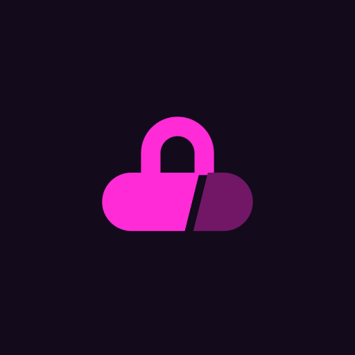
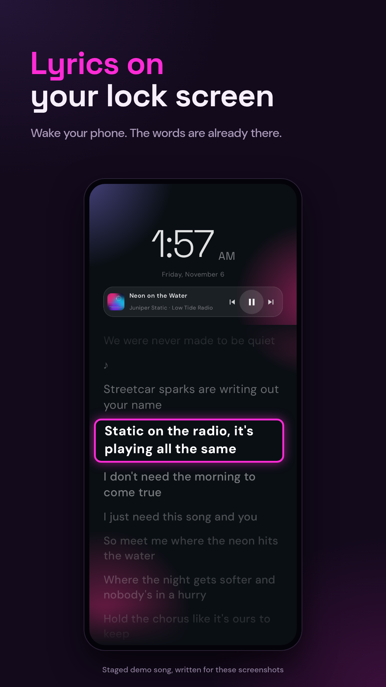
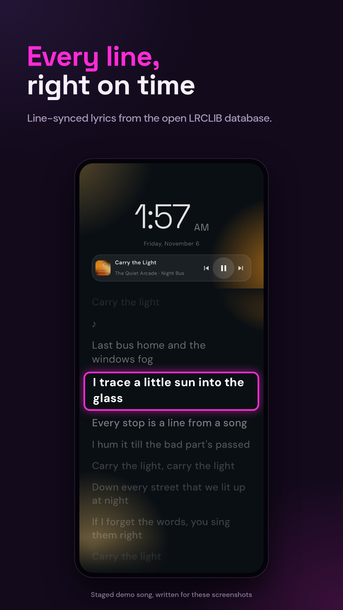
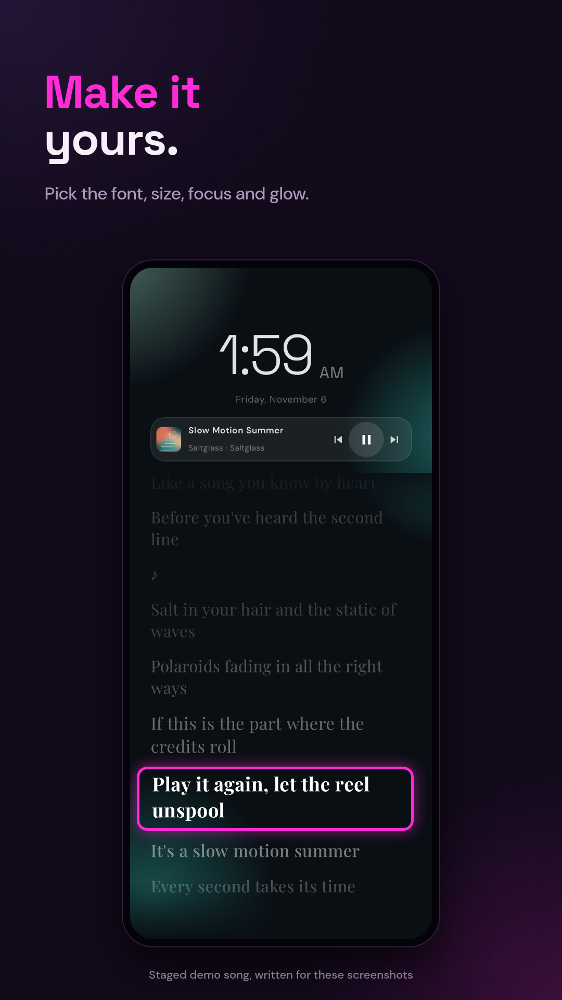
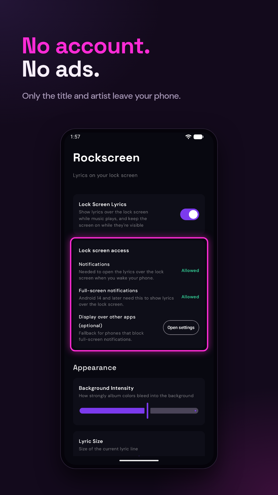

<p align="center"></p>

<h1 align="center">Rockscreen</h1>

<p align="center">Synced lyrics on your Android lock screen for whatever is playing.<br>
Free and open source (GPL-3.0). No account, no ads, no tracking.</p>

---

Play a song in your music app, wake your phone, and the lyrics are already on the lock screen, scrolling line by line
in time with the music. Unlock and they get out of the way.

- Works with music apps that show playback controls in your notifications (tested with Spotify).
- Line-synced lyrics from [LRCLIB](https://lrclib.net), the open, community-run lyrics database.
- Album-art colours, play/pause/skip, and settings for font, size, focus, background glow and the clock.
- Keeps the screen on while lyrics play over the lock screen; press power to turn it off.
- Closes as soon as you unlock, and doesn't open for songs without lyrics.

<p align="center">   </p>

<p align="center"><sub>Screenshots use demo songs written for them; the app UI is unedited.</sub></p>

## Install

Download the APK from [Releases](https://github.com/adit-0132/rockscreen/releases), or add the repository to
[Obtainium](https://github.com/ImranR98/Obtainium) to get updates. Requires Android 8.1 or newer.

### First run

1. **Notification access.** Rockscreen needs it to see what's playing. If the switch is greyed out (Android 13+ blocks it
   for apps installed from a browser): open *App info → ⋮ → Allow restricted settings*, then try again.
2. **Notifications** (Android 13+) and **full-screen notifications** (Android 14+): these let it open the lyrics over
   the lock screen.
3. **Display over other apps** (optional): a fallback for phones that block full-screen notifications.

You need a lock screen (swipe, pattern, PIN or password). With the lock screen set to *None*, Rockscreen has nowhere to
appear. If your phone unlocks the instant you wake it (for example a fingerprint sensor in the power button), wake it
another way, or leave it on a desk or stand while music plays.

## Permissions

| Permission | Why |
|---|---|
| Notification access (granted in Settings) | Read the current song, artist, album and playback position from the media session |
| `INTERNET` | Look up lyrics on lrclib.net |
| `POST_NOTIFICATIONS`, `USE_FULL_SCREEN_INTENT` | A silent full-screen notification that opens the lyrics over the lock screen when you wake the phone |
| `SYSTEM_ALERT_WINDOW` (optional, off unless you allow it) | Fallback for phones that block full-screen notifications |
| `WAKE_LOCK`, `ACCESS_NETWORK_STATE`, `RECEIVE_BOOT_COMPLETED`, `FOREGROUND_SERVICE` | Added by Android's WorkManager library, which runs the weekly cache clean-up and keeps it scheduled after a reboot. Rockscreen runs no foreground service of its own |

Notification access technically lets an app see every notification. Rockscreen only reads media sessions and the
artwork of media notifications, and stores nothing else.

## Privacy

Only the song title and artist leave your phone, sent to lrclib.net to find lyrics. No account, analytics, ads or
crash reporting. Lyrics are cached on the phone for 30 days (at most 500 songs). Full details: [PRIVACY.md](PRIVACY.md).

## Known issues

- If a lyrics lookup fails (offline, LRCLIB down), that song shows no lyrics for 30 days. Clearing the app's storage
  resets the cache.
- Lyrics are matched by title and artist only, so remixes, live versions and new releases are often missing, and a
  different edit of a song can drift out of time.
- Skipping quickly between songs can occasionally show the previous song's lyrics until the next track change.
- Some players send artwork Rockscreen can't load (then no art is shown), or resend their metadata often, which can
  briefly reset the lyrics to "Loading".
- Some LRC variants aren't handled correctly: lines with several timestamps, word-timed lyrics, `[offset]` tags, and
  timestamps without fractions.
- Tested on Android 15 (vivo, Spotify) and the Android 16 emulator. Other phones may handle full-screen
  notifications differently; the *Display over other apps* option is the fallback.

## Build

```sh
git clone https://github.com/adit-0132/rockscreen.git
cd rockscreen
./gradlew assembleDebug          # JDK 17 or 21
./gradlew testDebugUnitTest
```

Release builds read signing details from a git-ignored `keystore.properties` (`storeFile`, `storePassword`, `keyAlias`,
`keyPassword`); without it `assembleRelease` produces an unsigned APK.

Kotlin, Jetpack Compose, Room, DataStore, Ktor and Coil. The fonts (Space Grotesk, DM Sans, Playfair Display) are
bundled under the SIL Open Font License (`app/src/main/assets/licenses/`).

## How it was made

Rockscreen was built with substantial help from an AI coding assistant (Claude), and tested on a real phone and the
Android emulator.

## Credits

Lyrics come from [LRCLIB](https://lrclib.net) and its contributors. Rockscreen is not affiliated with LRCLIB, Spotify
or any music service.

## License

[GPL-3.0](LICENSE)
